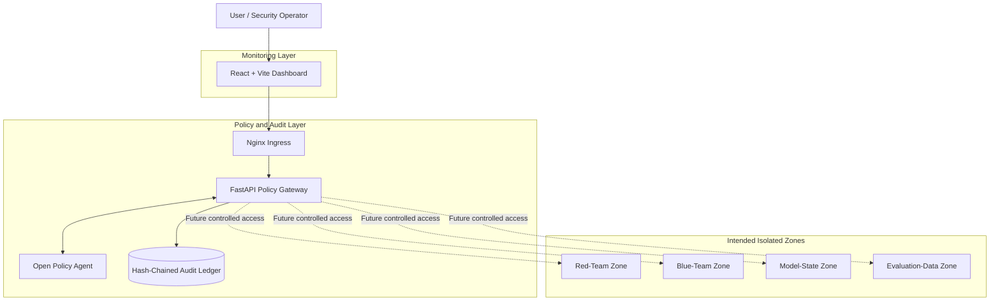
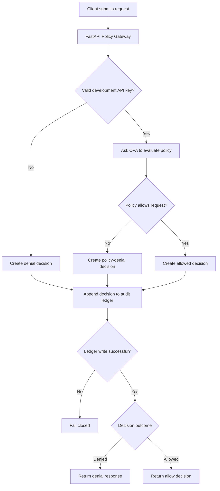
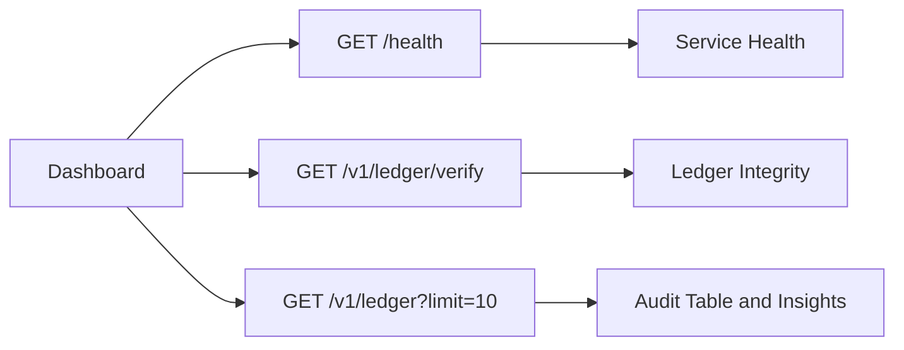
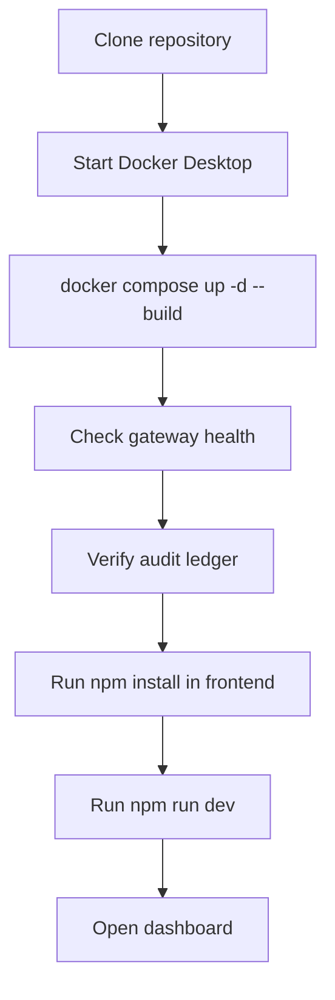
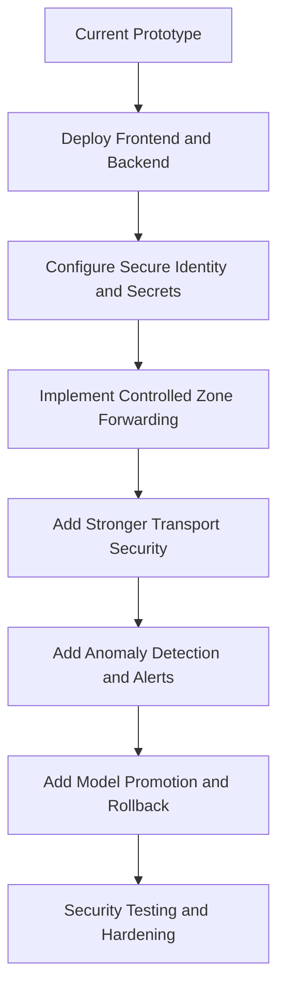

# SentinelMesh AI 🛡️
### Zero-Trust Infrastructure for Adversarial AI Testing

> Test AI attacks and defenses side by side, with nothing crossing a boundary unless it is checked and logged.

SentinelMesh AI is a security-focused prototype designed around isolating AI red-team testing, blue-team defense, model state, and evaluation data. A centralized policy gateway evaluates access requests, while a hash-chained audit ledger records access decisions.

| Project detail | Information |
|---|---|
| Hackathon | Hack in Hills '26 |
| Team | `git_happens` |
| Problem Statement | 04 — Bayora |
| Status | Working prototype under development |
| Repository | [GitHub](https://github.com/Aishwarya-112006/sentinelmesh-ai) |

## 📚 Table of Contents
- [Overview](#-overview)
- [Problem Statement](#-problem-statement)
- [Solution](#-our-solution)
- [Architecture](#️-system-architecture)
- [Request Flow](#-how-it-works)
- [Features](#-key-features)
- [Technology Stack](#️-technology-stack)
- [Dashboard](#-dashboard)
- [Getting Started](#-getting-started)
- [API Reference](#-api-reference)
- [Security](#-security-design)
- [Limitations](#️-current-limitations)
- [Roadmap](#️-future-roadmap)
- [Project Structure](#-project-structure)
- [Deployment](#-deployment)
- [Team and Contributing](#-team-and-contributing)
- [License](#-license)

## 🎯 Overview

AI security testing can require offensive and defensive teams to work with the same models, evaluation datasets, or infrastructure. Without clear boundaries, sensitive data may be exposed, testing activities may interfere with one another, and access decisions can be difficult to verify.

SentinelMesh AI explores a **zero-trust approach**: requests pass through a controlled gateway, access policies are evaluated by Open Policy Agent (OPA), and decisions are recorded in a hash-chained audit ledger.

| Component | Purpose |
|---|---|
| Policy Gateway | Central checkpoint for incoming requests |
| Open Policy Agent (OPA) | Evaluates access policies |
| Audit Ledger | Records access decisions in a hash-chained log |
| React Dashboard | Displays service health, ledger verification, and recent audit activity |
| Isolated Zone Design | Models separate red-team, blue-team, model-state, and evaluation-data environments |
| Docker Compose | Runs prototype services locally |

## 🚨 Problem Statement

| Challenge | Potential risk | SentinelMesh AI approach |
|---|---|---|
| Uncontrolled access between teams | Sensitive resources may cross boundaries | Route requests through a policy gateway |
| Weak access enforcement | Unauthorized requests may be accepted | Evaluate requests against explicit policies |
| Insufficient auditability | Decisions are hard to reconstruct | Record decisions in a hash-chained ledger |
| Shared model/evaluation resources | Model state or evaluation data may be exposed | Design separate zones with controlled access |
| Difficult log verification | Changes to records may go unnoticed | Verify the ledger's hash chain |

## 💡 Our Solution

1. **Zero-trust access:** Requests are checked rather than trusted automatically.
2. **Policy-based decisions:** OPA evaluates whether a request is allowed.
3. **Tamper-evident auditing:** Decisions are recorded in a hash-chained ledger that can be checked for integrity.

The current prototype demonstrates the gateway, policy evaluation, audit logging, ledger verification, and dashboard. Full inter-zone request forwarding and production-grade identity management are not yet implemented.

## 🏗️ System Architecture

Dotted connections in this diagram are planned design connections, not operational request forwarding.



| Component | Responsibility | Status |
|---|---|---|
| React + Vite | Dashboard interface and audit summaries | Implemented |
| Nginx Ingress | Exposes gateway on configured local port | Configured |
| FastAPI Gateway | Coordinates request checks, policy evaluation, and audit logging | Implemented |
| OPA | Evaluates authorization policy | Integrated |
| Audit Ledger | Stores hash-chained decisions | Implemented |
| Ledger Verification | Checks hash-chain integrity | Implemented |
| Isolated Zones | Separate red-team, blue-team, model-state, and evaluation-data environments | Intended design; full enforcement pending |

## 🔄 How It Works



| Step | Action |
|---:|---|
| 1 | A client sends a request to the gateway. |
| 2 | The gateway identifies the source using a development API key. |
| 3 | If the key check passes, OPA evaluates the access policy. |
| 4 | The gateway creates an access decision. |
| 5 | The decision is appended to the hash-chained ledger before the response is returned. |
| 6 | If the audit write fails, the gateway fails closed. |
| 7 | The client receives the response. |

> **Important:** An allowed response currently represents an authorization decision. It does not mean the request was forwarded to a protected zone.

## ✨ Key Features

| Feature | Description | Status |
|---|---|---|
| Centralized policy gateway | Single checkpoint for access requests | Implemented |
| OPA policy evaluation | Evaluates authorization rules | Integrated |
| Development API-key checks | Identifies configured development clients | Implemented |
| Hash-chained audit ledger | Links entries using cryptographic hashes | Implemented |
| Ledger integrity verification | Checks whether the recorded chain is valid | Implemented |
| Dashboard health monitoring | Displays backend health | Implemented |
| Audit activity table | Shows recent ledger records | Implemented |
| Audit insights | Allowed/denied counts and denial rate from retrieved records | Implemented |
| Inter-zone request forwarding | Routes approved requests to isolated services | Planned |
| Production identity and mTLS | Stronger client identity and transport authentication | Planned |
| Automated anomaly alerts | Detects suspicious patterns and raises alerts | Planned |
| Model promotion and rollback | Supports controlled model-state changes | Planned |

## 🧰 Technology Stack

| Technology | Role |
|---|---|
| React | Frontend UI |
| Vite | Frontend development and build tooling |
| JavaScript / CSS | Dashboard logic and styling |
| Python | Backend implementation |
| FastAPI | HTTP API and gateway |
| Uvicorn | ASGI application server |
| Open Policy Agent (OPA) | Policy evaluation |
| Nginx | Ingress and request routing |
| Docker | Containerization |
| Docker Compose | Local multi-service orchestration |
| JSON Lines | Audit-ledger record format |
| SHA-256 hashing | Hash-chain integrity mechanism |

## 📊 Dashboard

The dashboard provides an overview of the prototype's operational state.

- **Service health:** Checks whether the backend health endpoint responds.
- **Ledger verification:** Displays the audit ledger's integrity-verification result.
- **Recent audit activity:** Shows the latest retrieved ledger entries.
- **Audit insights:** Summarizes allowed and denied decisions and calculates denial rate from the records retrieved.



Live dashboard links will be added after deployment.

## 🚀 Getting Started

### Prerequisites

| Requirement | Purpose |
|---|---|
| Git | Clone and manage the repository |
| Docker Desktop | Run backend services |
| Node.js and npm | Run the frontend |
| Web browser | Open the dashboard |

### 1. Clone the repository

```bash
git clone https://github.com/Aishwarya-112006/sentinelmesh-ai.git
cd sentinelmesh-ai
```

### 2. Start Docker Desktop

Make sure Docker Desktop is running and Docker Compose is available.

### 3. Build and start backend services

Run from the repository root:

```bash
docker compose up -d --build
docker compose ps
```

Follow gateway logs if needed:

```bash
docker compose logs -f gateway
```

### 4. Check backend health

Open `http://localhost:8000/health`.

Example response:

```json
{
  "status": "ok"
}
```

### 5. Verify the audit ledger

Open `http://localhost:8000/v1/ledger/verify`.

Example valid response (the entry count can vary):

```json
{
  "valid": true,
  "entries": 18,
  "first_broken_index": null
}
```

### 6. Start the frontend

Open a second terminal:

```bash
cd frontend
npm install
npm run dev
```

Open the local URL printed by Vite, usually `http://localhost:5173`.

### 7. Stop services

```bash
docker compose down
```

The named ledger volume is separate from the containers, so stopping services normally preserves the ledger. Avoid volume-removal options unless you intend to delete persisted data.



## 🔌 API Reference

**Local base URL:** `http://localhost:8000`

| Method | Endpoint | Purpose |
|---|---|---|
| `GET` | `/health` | Check backend health |
| `POST` | `/v1/request` | Submit an access request for policy evaluation |
| `GET` | `/v1/ledger?limit=10` | Retrieve recent audit-ledger entries |
| `GET` | `/v1/ledger/verify` | Verify audit-ledger integrity |

### Health check

```http
GET /health
```

Example:

```json
{
  "status": "ok"
}
```

### Submit an access request

```http
POST /v1/request
```

This endpoint checks configured development credentials, evaluates applicable authorization policy, and records the decision in the ledger. The exact body and required headers depend on the gateway implementation; consult `src/gateway/app/main.py` for the current request contract.

An allowed result does not mean the request was forwarded to another service.

### Retrieve ledger entries

```http
GET /v1/ledger?limit=10
```

Returns recent ledger entries, subject to the endpoint's configured limit.

### Verify ledger integrity

```http
GET /v1/ledger/verify
```

A valid result indicates that the recorded hash chain passed the implemented integrity check. It does not prove every real-world action was captured or that the log is stored in an independently immutable system.

## 🔐 Security Design

| Principle | How the prototype applies it |
|---|---|
| Least privilege | Access is evaluated through explicit policy rules |
| Default-deny mindset | Unauthorized requests should not be permitted |
| Centralized enforcement | Requests pass through a common gateway |
| Auditability | Access decisions are written to a ledger |
| Tamper evidence | Hash chaining helps detect changes to recorded entries |
| Fail-closed behavior | Policy or ledger failures should not cause unintended successful authorization |

### Security considerations

- Development API keys are for prototype use, not production credentials.
- Store secrets securely and never commit them to the repository.
- Hash chaining can help reveal record changes but is not equivalent to an independently protected immutable audit service.
- Full inter-zone request forwarding, production-grade identity management, and mutual TLS are not yet implemented.
- Dashboard summaries reflect retrieved entries and are not a complete security analytics platform.
- Do not use this prototype to protect real sensitive data or as a production security boundary without further engineering and security review.

## ⚠️ Current Limitations

| Area | Current limitation |
|---|---|
| Zone isolation | The four-zone architecture is not yet fully enforced through end-to-end request forwarding |
| Request forwarding | The gateway returns an authorization result but does not deliver approved requests to protected zone services |
| Identity | Development API keys are used instead of a complete production identity system |
| Transport security | Production-grade mutual TLS is not yet implemented |
| Audit storage | The ledger is a local JSON Lines file backed by a Docker volume |
| Anomaly detection | Automated anomaly detection and alerting are not yet implemented |
| Model lifecycle | Model promotion and rollback are not yet implemented |
| Production readiness | Additional hardening, deployment configuration, monitoring, and testing are required |

## 🗺️ Future Roadmap



| Phase | Planned work |
|---|---|
| 1 | Deploy the dashboard and backend and publish live URLs |
| 2 | Improve secret handling and client authentication |
| 3 | Implement controlled request forwarding between isolated zones |
| 4 | Strengthen transport security and audit storage |
| 5 | Add anomaly detection and operational alerts |
| 6 | Add controlled model promotion and rollback |
| 7 | Perform comprehensive security and reliability testing |

These are planned milestones, not claims that the capabilities are already available.

## 📁 Project Structure

```text
sentinelmesh-ai/
├── frontend/                 # React + Vite dashboard
├── src/
│   └── gateway/
│       ├── app/
│       │   └── main.py       # FastAPI gateway and API endpoints
│       ├── requirements.txt  # Python dependencies
│       └── Dockerfile.test   # Gateway container build
├── docker-compose.yml        # Local service orchestration
├── README.md                 # Project documentation
└── .gitignore                # Files excluded from Git
```

The exact directory contents may evolve; consult the repository for the latest files and configuration.

## 🌐 Deployment

Replace the placeholders after deploying and testing the services.

| Resource | Link |
|---|---|
| Live Frontend | Coming soon |
| Backend API | Coming soon |
| Backend Health | Coming soon |
| Ledger Verification | Coming soon |
| GitHub Repository | [SentinelMesh AI](https://github.com/Aishwarya-112006/sentinelmesh-ai) |

## 👥 Team and Contributing

| Detail | Information |
|---|---|
| Team name | `git_happens` |
| Hackathon | Hack in Hills '26 |
| Problem statement | 04 — Bayora |
| Project | SentinelMesh AI |

Contributions, suggestions, and bug reports are welcome.

1. Fork the repository.
2. Create a feature branch.
3. Make and test your changes.
4. Commit with a descriptive message.
5. Open a pull request describing the change.

Do not publish credentials, private keys, or sensitive system details in public issues.

## 📜 License

A license has not yet been specified. Until one is added to the repository, do not assume the project is available for unrestricted reuse or redistribution.

---

**SentinelMesh AI — Test boldly. Enforce boundaries. Verify every decision.** 🛡️
