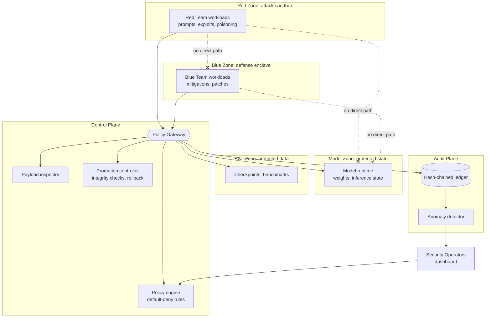
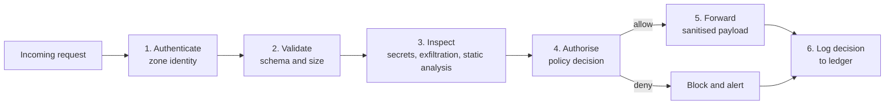
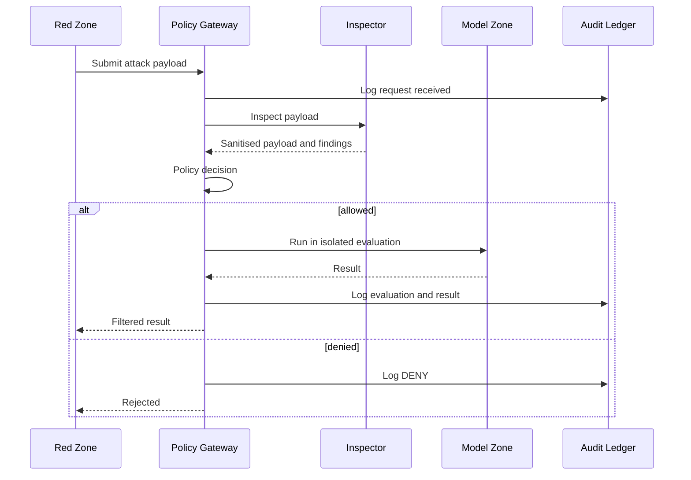
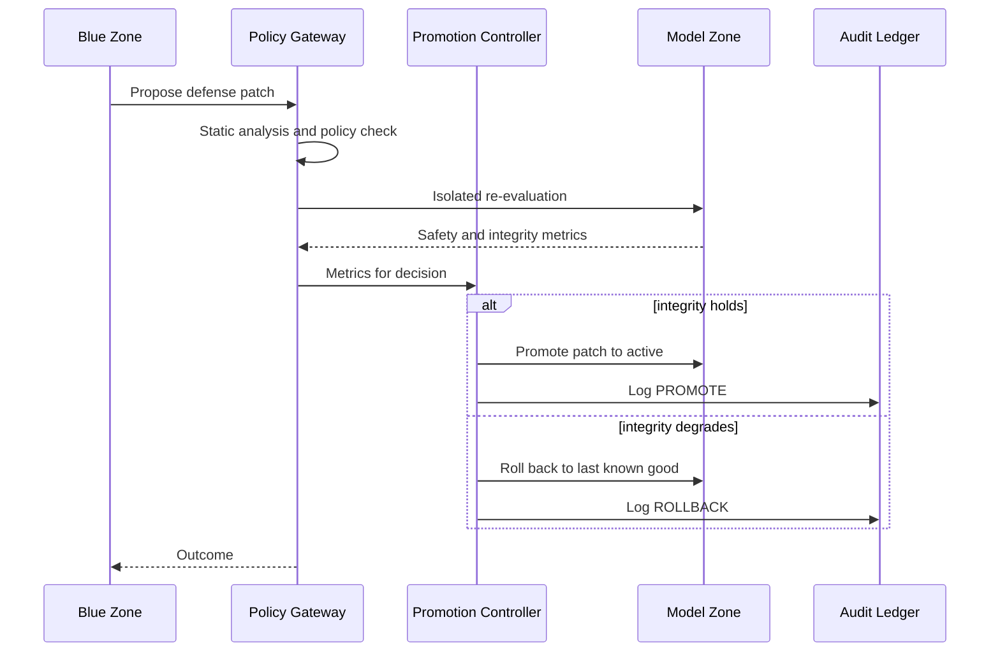
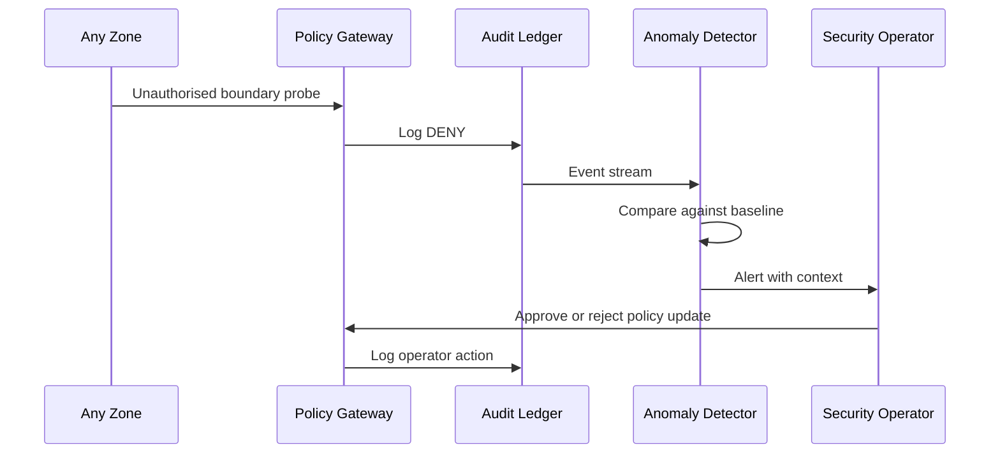
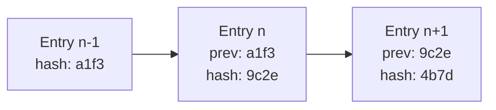

# SentinelMesh AI: Architecture

> **Status:** Target design. The current prototype is a simulation of this architecture, so the components below are not yet implemented.
> **Core idea:** Four isolated zones, one checkpoint between them, and a tamper-evident record of everything that happens.

---

## 1. Design principles

| Principle | What it means here |
|---|---|
| **Default deny** | No traffic between zones unless an explicit rule allows it |
| **Single choke point** | The Policy Gateway is the only path between zones |
| **Least privilege** | Each zone and role gets only the access its job needs |
| **No implicit trust** | Every request is authenticated, authorised and logged, even from inside |
| **Assume breach** | A compromised zone must not be able to reach another zone or the internet |
| **Evidence by default** | Every decision produces a tamper-evident audit record |

---

## 2. System overview

The system has three planes:

- **Data plane:** the four zones and the traffic between them.
- **Control plane:** the gateway and everything it calls to decide, inspect and promote.
- **Audit plane:** the ledger and the anomaly detector, which observe the control plane and feed operators.

---

## 3. Zones and trust boundaries

Each zone is a separate trust domain. A trust boundary exists between every pair of zones.

| Zone | Contains | Trust level | Can initiate calls to |
|---|---|---|---|
| **Red** | Attack payloads, adversarial prompts, exploit tooling | Untrusted | Gateway only |
| **Blue** | Defense logic, patches, countermeasures | Semi-trusted | Gateway only |
| **Model** | Weights, inference state, runtime | Protected | Nothing (responds to gateway only) |
| **Eval** | Checkpoints, benchmark data | Protected | Nothing (responds to gateway only) |
| **Control plane** | Gateway, policy engine, inspector, promotion controller | Trusted computing base | Model, Eval, Audit |
| **Audit plane** | Ledger, anomaly detector | Trusted, append-only | Operators (alerts) |

### Network reachability matrix

`✅` allowed through the gateway under a rule · `❌` no network route at all

| From ↓ / To → | Red | Blue | Model | Eval | Gateway | Internet |
|---|---|---|---|---|---|---|
| **Red** | – | ❌ | ❌ | ❌ | ✅ | ❌ |
| **Blue** | ❌ | – | ❌ | ❌ | ✅ | ❌ |
| **Model** | ❌ | ❌ | – | ❌ | ✅ (reply only) | ❌ |
| **Eval** | ❌ | ❌ | ❌ | – | ✅ (reply only) | ❌ |
| **Gateway** | ❌ | ✅ (sanitised signals) | ✅ | ✅ | – | ❌ |

Reachability in the table means a network route exists. Whether a *specific request* is allowed is decided per request by policy.

**Egress is blocked everywhere.** No zone can reach the internet. This matters because real-world evaluation incidents have involved a model escaping its sandbox to external systems, not just crossing internal zones.

---

## 4. The Policy Gateway

The gateway is the only component allowed to move data between zones. It is built as a **policy enforcement point (PEP)** that asks a separate **policy decision point (PDP)** for every request.

**Pipeline stages**

1. **Authenticate:** verify the caller's zone identity (short-lived token now, mutual TLS later).
2. **Validate:** enforce schema, size limits and content type. Reject malformed input early.
3. **Inspect:** scan for secrets and exfiltration vectors, and statically analyse Blue Team modules.
4. **Authorise:** ask the policy engine whether this *source, destination, action and role* combination is allowed. The answer defaults to deny.
5. **Forward:** pass on only the sanitised payload, never the original.
6. **Log:** write the decision, allow or deny, to the ledger *before* returning a response. If logging fails, the request fails (fail closed).

---

## 5. Key workflows

### 5.1 Red Team cycle: attack evaluation

The Red Team never touches the model directly. It sees only a **filtered result**, which limits what it can learn about model internals through outputs.

### 5.2 Blue Team cycle: defense promotion and rollback

A patch becomes active only after passing integrity checks and audit review. If model safety metrics fall, the controller restores the **last known-good state** automatically.

### 5.3 Anomaly detection and escalation

Alerts do **not** halt running evaluations. Operators review them and decide whether to change policy.

---

## 6. The audit ledger

Every event becomes a chained record.

**Each entry contains:** timestamp, actor and zone, source and destination, action, decision (allow, deny, inspect, promote, rollback, alert), payload hash, previous entry's hash, its own hash and a signature.

**Why it is tamper-evident**
- Changing any past entry changes its hash, which breaks every later link.
- The writer has insert-only access, with no update or delete permission.
- Periodic checkpoint hashes are **published outside the system**, so an attacker who controls the ledger still cannot rewrite history unnoticed.
- A verifier tool walks the chain and reports the first broken link.

---

## 7. Policy model

Policies are written as code, stored in version control, and tested.

A rule is evaluated over: **source zone · destination zone · action · caller role · payload attributes.**

Illustrative examples (in plain language):

| Rule | Decision |
|---|---|
| Red → Model, any action | **Deny** (no rule exists) |
| Red → Gateway, submit payload, size under limit | **Allow**, with inspection |
| Gateway → Blue, sanitised threat signal | **Allow** |
| Blue → Gateway, propose patch, static analysis passed | **Allow**, with promotion check |
| Anything not matched | **Deny** |

**Governance:** policy changes are proposed, reviewed and approved by a Security Operator, then logged. Automated tools may *suggest* rules, but they cannot activate them.

---

## 8. Failure modes and responses

| Failure | Response |
|---|---|
| Gateway unavailable | **Fail closed.** No traffic crosses zones |
| Policy engine unreachable | Default **deny** |
| Ledger write fails | Request **fails**. Nothing proceeds unlogged |
| Inspector flags a payload | Block or sanitise, log, alert |
| Patch degrades safety metrics | Automatic **rollback** to last known good |
| Zone compromised | Zone has no route to other zones or the internet. Operators isolate or tear down the zone |
| Anomaly detector offline | Enforcement continues. Alerting degrades and a health alert is raised |

---

## 9. Threat considerations and known limits

| Threat | Mitigation | Residual risk |
|---|---|---|
| Lateral movement between zones | No routes, default deny | Kernel-level container escape |
| Payload exfiltrates data | Egress blocked, inspection | Covert channels in permitted outputs |
| Model extraction via results | Output filtering, rate limits | Slow, patient extraction |
| Gateway compromise | Minimal code, hardened, itself logged | Gateway is a high-value single point of failure |
| Ledger tampering | Hash chain, external checkpoints | Compromise of signing keys |
| Side channels | Resource limits, separate runtimes | Shared hardware timing channels |
| Malicious policy change | Operator approval, versioned, logged | Insider or stolen operator credentials |

Inspection is a best-effort layer. Adversarial content is hard to detect completely, so containment (isolation and egress control) is the primary defense and inspection is secondary.

---

## 10. Deployment views

| | MVP | Production |
|---|---|---|
| **Runtime** | Docker containers, isolated networks | Kubernetes with microVM runtime |
| **Network enforcement** | Docker internal networks | Network policies (for example Cilium) plus mutual TLS |
| **Gateway** | Single instance | Replicated, with health checks |
| **Ledger store** | Single database | Replicated, with external checkpoint publication |
| **Operators** | Local dashboard | Dashboard with SSO and role-based access control |

---

## 11. Scalability

- **More models:** add a Model zone per model, each behind the same gateway, with per-model policies.
- **More teams:** add Red or Blue zones from reusable policy templates (the deck estimates a 60% onboarding reduction, which is a target, not a measured result).
- **Throughput:** scale the gateway horizontally. The ledger needs ordered writes, so partition per tenant or session.

---

*Related: [product.md](product.md) · [tech_stack.md](tech_stack.md) · [README.md](README.md)*
