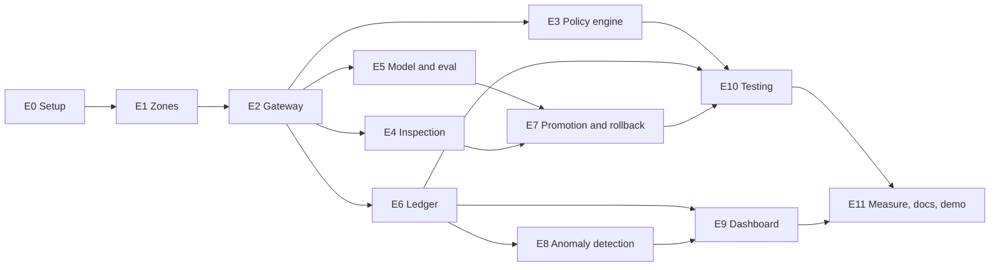

# SentinelMesh AI: Task Breakdown

> **Purpose:** Break the project into concrete, buildable tasks, with what each task involves, what it produces, what it depends on, and how to tell it is done.
> **Estimates:** Rough hours for one developer. Treat them as planning guesses, not commitments.
> **Legend:** ⭐ = included in the **thin slice** (the smallest real build that proves the core claims, see section 3). **P0** must have · **P1** should have · **P2** nice to have.

---

## 1. Overview

| Epic | Area | Est. hours |
|---|---|---|
| E0 | Project setup | 4 |
| E1 | Zone isolation | 9 |
| E2 | Policy Gateway | 12 |
| E3 | Policy engine | 9 |
| E4 | Payload inspection | 7 |
| E5 | Model and eval zones | 8 |
| E6 | Audit ledger | 11 |
| E7 | Promotion and rollback | 10 |
| E8 | Anomaly detection | 7 |
| E9 | Dashboard | 14 |
| E10 | Testing | 9 |
| E11 | Measurement, docs and demo | 11 |
| | **Total (all tasks)** | **≈ 111** |
| | **Thin slice only (⭐)** | **≈ 50** |

### Epic dependencies

**Critical path:** E0 → E1 → E2 → E3 → E6 → E10 → E11. Delays on these delay everything else.

---

## 2. Tasks by epic

### E0: Project setup

| ID | Task | Details | Output | Depends on | Est. | Pri | Done when |
|---|---|---|---|---|---|---|---|
| T0.1 ⭐ | Create repo structure | Folders for `src/gateway`, `src/policies`, `src/zones`, `src/audit`, `src/dashboard`, `tests`, `docs` | Folder skeleton in Git | – | 1h | P0 | Structure pushed to GitHub |
| T0.2 | Basic CI | GitHub Actions running lint and tests on each push | Workflow file | T0.1 | 2h | P1 | Pipeline passes on `main` |
| T0.3 ⭐ | Compose skeleton | `docker-compose.yml` with placeholder services | Compose file | T0.1 | 1h | P0 | `docker compose up` starts all placeholders |

### E1: Zone isolation

| ID | Task | Details | Output | Depends on | Est. | Pri | Done when |
|---|---|---|---|---|---|---|---|
| T1.1 ⭐ | Build zone images | Separate images for Red, Blue, Model, Eval | 4 Dockerfiles | T0.3 | 3h | P0 | Each container starts and runs a health check |
| T1.2 ⭐ | Network isolation | One internal network per zone, each joined to the gateway only | Compose network config | T1.1 | 3h | P0 | Red cannot ping Model or Blue |
| T1.3 | Container hardening | Non-root user, read-only filesystem, dropped capabilities, `no-new-privileges`, resource limits | Hardened compose config | T1.1 | 2h | P1 | Security flags verified with `docker inspect` |
| T1.4 ⭐ | Verify no egress | Test that no zone can reach the internet | Egress test script | T1.2 | 1h | P0 | Outbound requests from every zone fail |

### E2: Policy Gateway

| ID | Task | Details | Output | Depends on | Est. | Pri | Done when |
|---|---|---|---|---|---|---|---|
| T2.1 ⭐ | Gateway skeleton | FastAPI app, health endpoint, config loading | Running service | T1.2 | 2h | P0 | `/health` returns OK from inside the network |
| T2.2 ⭐ | Zone authentication | Issue short-lived JWT per zone identity and verify on each request | Auth module | T2.1 | 3h | P0 | Requests without a valid token are rejected |
| T2.3 | Request validation | Schema, size limit and content-type checks | Validation layer | T2.1 | 2h | P1 | Malformed and oversized requests return an error |
| T2.4 ⭐ | Routing and forwarding | Forward permitted requests to Model, Eval and Blue | Routing module | T2.2 | 3h | P0 | Red request reaches Model only through the gateway |
| T2.5 ⭐ | Fail-closed behaviour | If policy engine or ledger is unreachable, reject the request | Error handling | T2.4 | 2h | P0 | Stopping the policy engine blocks all traffic |

### E3: Policy engine

| ID | Task | Details | Output | Depends on | Est. | Pri | Done when |
|---|---|---|---|---|---|---|---|
| T3.1 ⭐ | Run OPA | Add OPA as a service reachable by the gateway only | OPA container | T2.1 | 2h | P0 | Gateway can query OPA |
| T3.2 ⭐ | Write base policies | Default deny, plus allow rules per zone pair, action and role | Rego files | T3.1 | 3h | P0 | Unlisted requests are denied, listed ones allowed |
| T3.3 ⭐ | Gateway–OPA integration | Gateway sends source, destination, action and role, and enforces the answer | OPA client | T3.2, T2.4 | 2h | P0 | Decisions change when policy changes |
| T3.4 | Policy unit tests | `opa test` cases for each rule, including denials | Test files | T3.2 | 2h | P1 | All policy tests pass in CI |

### E4: Payload inspection

| ID | Task | Details | Output | Depends on | Est. | Pri | Done when |
|---|---|---|---|---|---|---|---|
| T4.1 ⭐ | Secret and exfiltration scan | Detect and strip tokens, keys and external URLs | Inspector module | T2.4 | 3h | P0 | Seeded secrets are removed from forwarded payloads |
| T4.2 | Size and content limits | Reject payloads over limits or with disallowed types | Inspector rules | T4.1 | 1h | P1 | Oversized payload is blocked and logged |
| T4.3 | Static analysis of patches | Run Semgrep and Bandit on Blue Team modules before promotion | Analysis step | T4.1 | 3h | P1 | A patch with a seeded unsafe pattern is rejected |

### E5: Model and eval zones

| ID | Task | Details | Output | Depends on | Est. | Pri | Done when |
|---|---|---|---|---|---|---|---|
| T5.1 ⭐ | Model runtime | Small local model via Ollama. **For the thin slice, a mock model that returns canned results is enough (≈1h)** | Model service | T1.1 | 3h (1h mock) | P0 | Gateway can request an inference and get a reply |
| T5.2 | Inference API wrapper | Expose inference only, no weights or file access | Wrapper API | T5.1 | 2h | P1 | No endpoint exposes model files |
| T5.3 | Eval data store | Read-only volume with checkpoints and benchmarks | Mounted volume | T1.1 | 1h | P1 | Writes to the volume fail |
| T5.4 | Output filtering and rate limits | Filter results returned to Red and cap request rates | Filter and limiter | T5.2 | 2h | P1 | Excess requests are throttled and logged |

### E6: Audit ledger

| ID | Task | Details | Output | Depends on | Est. | Pri | Done when |
|---|---|---|---|---|---|---|---|
| T6.1 | Ledger schema | PostgreSQL table and an insert-only database role | SQL migration | T0.3 | 2h | P1 | UPDATE and DELETE are refused for the writer role |
| T6.2 ⭐ | Hash-chain writer | Each entry stores previous hash and its own SHA-256. Gateway writes before replying. **Thin slice can use SQLite or a JSONL file** | Writer module | T2.1 | 3h | P0 | Each request creates a chained entry |
| T6.3 | Entry signing | Sign entries with Ed25519 | Signing module | T6.2 | 2h | P1 | Signatures verify with the public key |
| T6.4 ⭐ | Chain verifier | Script that walks the chain and reports the first broken link | Verifier tool | T6.2 | 2h | P0 | Edited entry is detected and reported |
| T6.5 | External checkpoints | Publish a checkpoint hash outside the system on a schedule | Checkpoint job | T6.4 | 2h | P2 | Checkpoints appear in a separate repo |

### E7: Promotion and rollback

| ID | Task | Details | Output | Depends on | Est. | Pri | Done when |
|---|---|---|---|---|---|---|---|
| T7.1 | Patch proposal endpoint | Blue Team submits a defense patch through the gateway | API endpoint | T2.4 | 2h | P1 | Proposal is logged and queued |
| T7.2 | Integrity metric | Define and compute an integrity and safety score by re-running evaluations | Metric function | T5.1 | 3h | P1 | Score is produced for a patch |
| T7.3 | Promote and rollback controller | Promote if score meets threshold, otherwise restore last known good | Controller | T7.2, T7.4 | 3h | P1 | Failing patch triggers automatic rollback |
| T7.4 | Known-good store | Versioned store of the last approved state | State store | T7.1 | 2h | P1 | Rollback restores the previous version exactly |

### E8: Anomaly detection

| ID | Task | Details | Output | Depends on | Est. | Pri | Done when |
|---|---|---|---|---|---|---|---|
| T8.1 | Event stream | Publish gateway events to Redis pub/sub | Publisher | T6.2 | 2h | P1 | Subscribers receive events in real time |
| T8.2 | Rule-based baselines | Alert on repeated denials, boundary probes, unusual request rates | Detector | T8.1 | 3h | P1 | Simulated probe raises an alert |
| T8.3 | Alert delivery | Send alerts to the dashboard | Alert channel | T8.2 | 2h | P1 | Alert shows within seconds |
| T8.4 | ML detection *(Phase 2)* | Isolation Forest on event features. Suggestions need operator approval | Model and pipeline | T8.2 | 5h | P2 | Detector flags a seeded outlier |

### E9: Dashboard

| ID | Task | Details | Output | Depends on | Est. | Pri | Done when |
|---|---|---|---|---|---|---|---|
| T9.1 | Scaffold | React, TypeScript, Vite, Tailwind | App skeleton | T0.1 | 2h | P1 | App runs locally |
| T9.2 ⭐ | Zone map | Hub-and-spoke diagram with the "no direct path" line | Map component | T9.1 | 4h | P0 | Matches the demo layout |
| T9.3 ⭐ | Live ledger panel | WebSocket feed showing time, action, route, hash | Ledger component | T6.2, T9.1 | 3h | P0 | New entries appear live |
| T9.4 | Alert banner and integrity bar | Top banner for anomalies, progress bar for integrity score | UI components | T8.3, T7.2 | 2h | P1 | Matches demo behaviour |
| T9.5 | Scenario runner | Button that triggers the four demo scenarios against the real backend | Demo mode | T9.3 | 3h | P1 | All four scenarios run end to end |

### E10: Testing

| ID | Task | Details | Output | Depends on | Est. | Pri | Done when |
|---|---|---|---|---|---|---|---|
| T10.1 ⭐ | Boundary test suite | Automated attempts to cross every forbidden route (Red→Model, Red→Blue, zone→internet) | `tests/boundary` | T3.3, T1.4 | 4h | P0 | Every attempt is blocked and logged |
| T10.2 ⭐ | Ledger tamper test | Edit a stored entry and confirm the verifier catches it | `tests/ledger` | T6.4 | 2h | P0 | Test fails the chain at the edited row |
| T10.3 | Fail-closed tests | Stop OPA, the ledger or the gateway and confirm nothing crosses | Test cases | T2.5 | 2h | P1 | No traffic passes in any failure case |
| T10.4 | End-to-end scenario tests | Automate the four demo scenarios | Test suite | T9.5 | 3h | P2 | Suite passes in CI |

### E11: Measurement, documentation and demo

| ID | Task | Details | Output | Depends on | Est. | Pri | Done when |
|---|---|---|---|---|---|---|---|
| T11.1 | Measure real numbers | Compute containment, detection and traceability from the test suites | `eval/results.md` | T10.1–T10.3 | 3h | P1 | Figures come from real runs, with method stated |
| T11.2 | Update the deck | Replace design targets with measured figures, add incident slide and threat model | Updated `.pptx` | T11.1 | 3h | P1 | Every figure is marked measured or target |
| T11.3 ⭐ | Record demo video | Capture the real system running the scenarios | New demo video | T9.5 (or T9.3) | 3h | P0 | Video shows real backend behaviour |
| T11.4 | Finalise docs | Update README and link all documents | Docs | T11.1 | 2h | P1 | Docs match what is built |

---

## 3. Thin slice: the smallest build that proves the claims

If time is short, build only the ⭐ tasks. In about **50 hours** it delivers:

1. Four isolated containers with no cross-zone routes and no internet.
2. A gateway that authenticates, checks policy (default deny), logs, and fails closed.
3. A hash-chained ledger with a verifier.
4. A dashboard with the zone map and live ledger.
5. Automated tests proving every forbidden route is blocked and tampering is detected.

That is enough to say "this is real, and here is the evidence" instead of "this is a simulation". Promotion and rollback, ML detection and integrations then stay as clearly labelled future work.

---

## 4. Suggested build order

| Step | Tasks | Milestone |
|---|---|---|
| 1 | T0.1, T0.3, T1.1, T1.2, T1.4 | Isolated zones, no egress |
| 2 | T2.1, T2.2, T2.4, T3.1–T3.3 | Gateway enforcing default deny |
| 3 | T6.2, T6.4, T2.5 | Logged, verifiable, fails closed |
| 4 | T4.1, T5.1 | Inspection and a model to test against |
| 5 | T10.1, T10.2 | Proof that boundaries hold and tampering is caught |
| 6 | T9.2, T9.3 | Live dashboard |
| 7 | T11.3 | Real demo recording |
| 8 | Remaining P1 tasks | Promotion, anomaly detection, hardening |
| 9 | P2 tasks | Checkpoints, ML detection, end-to-end CI |

---

## 5. Risks to the plan

| Risk | Impact | Mitigation |
|---|---|---|
| Docker networking is trickier than expected | Delays E1 and everything after | Build and test isolation first. Test with `internal: true` networks early |
| Running a real model is slow or heavy | Delays E5 and E7 | Use a mock model for the thin slice |
| Integrity metric is hard to define | Weakens promotion and rollback | Start with a simple proxy such as pass rate on a fixed test set, and label it as such |
| Dashboard takes too long | Weak demo | Reuse the demo's layout, build the map and ledger first |
| Scope creep | Nothing finished | Hold to the ⭐ list until it is done |
| Estimates are low | Overrun | Add 30% buffer on any task that touches networking or authentication |

---

## 6. Definition of done (for any task)

- Code is committed and pushed.
- It has a test, or a clear manual check recorded in the task.
- It writes to the ledger where it makes a decision.
- Docs are updated if behaviour changed.
- No secrets in Git.

---

*Related: [product.md](product.md) · [architecture.md](architecture.md) · [tech_stack.md](tech_stack.md) · [design.md](design.md) · [README.md](README.md)*
