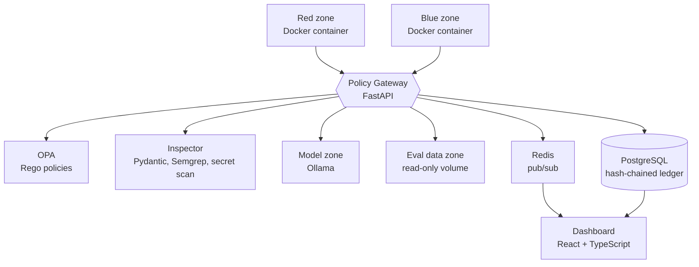

# SentinelMesh AI: Tech Stack

> **Status:** Proposed stack. The current prototype is a simulation, so none of the backend components below are built yet.
> **Design goals:** (1) enforce isolation for real, (2) be buildable by one developer in a hackathon, (3) have a clear upgrade path to production.

---

## 1. Stack at a glance

| Layer | MVP (Phase 1) | Production path (Phase 2–3) |
|---|---|---|
| **Zone isolation** | Docker containers on isolated networks | gVisor, then Firecracker / Kata microVMs |
| **Policy Gateway** | Python + FastAPI | Envoy proxy with ext_authz |
| **Policy engine** | Open Policy Agent (OPA), Rego rules | OPA bundles with signed policy distribution |
| **Payload inspection** | Pydantic schemas, secret scanning, Semgrep | Sandboxed detonation, ML classifiers |
| **Protected model** | Small local model via Ollama | Multi-model serving (vLLM, Triton) |
| **Audit ledger** | Hash-chained log in PostgreSQL, Ed25519 signed | Merkle tree ledger (Trillian) with external anchoring |
| **Anomaly detection** | Rule-based baselines | scikit-learn Isolation Forest, then streaming ML |
| **Live events** | Redis pub/sub + WebSocket | NATS or Kafka |
| **Dashboard** | React + TypeScript + Vite + Tailwind | Same, plus RBAC and SSO |
| **Identity & secrets** | Per-zone JWT, Docker secrets | mTLS (SPIFFE/SPIRE), HashiCorp Vault |
| **Observability** | Structured JSON logs | Prometheus, Grafana, OpenTelemetry |
| **CI/CD** | GitHub Actions | Same, plus image signing |
| **Deployment** | Docker Compose | Kubernetes with Cilium network policies |
| **Integrations** | – | SIEM (Splunk / Elastic), SOAR, CI/CD hooks |

---

## 2. How the stack maps to the architecture



---

## 3. Component details and rationale

### 3.1 Zone isolation: Docker, then stronger sandboxes
- **Red, Blue, Model and Eval zones** each run in their own container on a **separate Docker network** created with `internal: true`, which blocks outbound internet access (egress control).
- Zones can only reach the gateway. There is no network route between them.
- Hardening flags: non-root user, read-only root filesystem, dropped Linux capabilities, `no-new-privileges`, seccomp profile, CPU and memory limits.
- **Upgrade path:** run containers under **gVisor** (`runsc`) for a user-space kernel, then **Firecracker** or **Kata Containers** microVMs for hardware-level isolation.
- *Why:* Docker is quick to build and demo. The upgrade path matters because containers share the host kernel, so a kernel escape would bypass the zones.

### 3.2 Policy Gateway: FastAPI and OPA
- **FastAPI (Python)** is the single entry point. Every request is authenticated, inspected, authorised and logged before it is forwarded.
- **OPA** evaluates authorization as policy-as-code in **Rego**: *default deny*, with explicit allow rules per zone pair, action and role.
- Policies live in Git, so every rule change is reviewable and versioned.
- *Why:* separating the enforcement point (gateway) from the decision point (OPA) follows the NIST SP 800-207 zero-trust model and makes rules auditable.
- **Upgrade path:** Envoy proxy with OPA as an external authorizer, for production-grade throughput.

### 3.3 Payload inspection
- **Schema validation** (Pydantic): reject malformed or oversized artifacts.
- **Secret and exfiltration scanning:** strip tokens, keys and URLs (regex plus `detect-secrets`).
- **Static analysis** of Blue Team defense modules: **Semgrep** and **Bandit** before any promotion.
- **Sandboxed execution:** run payloads against the model only inside the isolated model zone.
- *Known limit:* static inspection of adversarial inputs is incomplete. Treat it as one layer of defense, not a guarantee.

### 3.4 Protected model
- **Ollama** (or llama.cpp) serving a small open-weight model locally, so no external API calls leave the sandbox.
- The model zone exposes only an inference endpoint to the gateway, never weights or files.
- Output filtering and rate limits at the gateway reduce model-extraction risk.
- **Upgrade path:** vLLM or Triton for concurrent multi-model serving.

### 3.5 Audit ledger
- **PostgreSQL** table, append-only (insert-only database role, no UPDATE or DELETE grants).
- Each entry stores: timestamp, actor, zone pair, action, decision, payload hash, **previous entry's hash**, and its own **SHA-256** hash, forming a hash chain.
- Entries are **signed with Ed25519**, and a periodic checkpoint hash is published outside the system (for example, committed to a separate Git repo) so tampering is detectable.
- A verification script walks the chain and reports the first broken link.
- **Upgrade path:** Merkle-tree transparency log (**Trillian**, as used by Certificate Transparency).

### 3.6 Anomaly detection
- **MVP:** rule-based. Per-zone baselines for request rate, denied-request count and unusual targets, with thresholds that raise alerts.
- **Phase 2:** **scikit-learn Isolation Forest** on gateway event features.
- **Important:** ML may *suggest* policy changes, but a human Security Operator must approve them. Never auto-generate allow rules in a default-deny system.

### 3.7 Dashboard
- **React + TypeScript + Vite + Tailwind CSS.**
- **WebSocket** feed from the gateway (via Redis pub/sub) powers the live ledger panel.
- **React Flow** (or inline SVG) for the zone diagram, matching the demo video.
- Views: live zone map, audit ledger, alerts, patch promotion and rollback status.

### 3.8 Identity, secrets and transport
- **MVP:** short-lived **JWTs** per zone identity, secrets via Docker secrets (never in images or Git).
- **Production:** **mTLS** between all components with **SPIFFE/SPIRE** workload identity, secrets in **HashiCorp Vault**.

### 3.9 Observability
- Structured JSON logs from every component, correlated by request ID.
- **Prometheus + Grafana** for metrics (denied requests, latency, containment events). **OpenTelemetry** for tracing.
- Keep operational logs separate from the security audit ledger.

### 3.10 DevOps and quality
- **GitHub Actions:** lint (`ruff`), tests (`pytest`), policy tests (`opa test`), dependency and image scanning (**Trivy**), static scan (**Semgrep**).
- **Tests that matter most:** a red-team test suite that tries to cross each boundary and asserts it is blocked, and a ledger tamper test that edits a row and asserts the verifier catches it.
- **Deployment:** Docker Compose for the MVP. **Kubernetes** with **Cilium** (or NetworkPolicies) for Phase 3.

### 3.11 Enterprise integrations (Phase 3)
- Export events to **SIEM** (Splunk, Elastic) via syslog or webhook, **SOAR** playbook triggers, and CI/CD gates for model release.
- **RBAC** with OIDC/SSO and compliance reports mapped to NIST AI RMF.

---

## 4. Phased rollout

| Phase | Build |
|---|---|
| **1. MVP** | Docker Compose with 4 isolated zones, FastAPI gateway with OPA default-deny, hash-chained ledger, basic dashboard, boundary-crossing test suite |
| **2. Hardening** | gVisor runtime, payload inspection pipeline, rule-based then ML anomaly detection, signed ledger checkpoints, Prometheus/Grafana |
| **3. Scale** | Kubernetes and Cilium, mTLS and Vault, multi-model serving, SIEM/SOAR/CI-CD integrations, RBAC and compliance reporting |

---

## 5. Alternatives considered

| Choice | Alternative | Why not (for now) |
|---|---|---|
| FastAPI | Go or Rust gateway | Faster, but slower for one developer to build |
| OPA | Hand-written `if` rules | Not auditable, not testable as policy |
| PostgreSQL ledger | Blockchain | Heavy and unnecessary. A hash chain with external anchoring gives tamper evidence |
| Docker | Full VMs | Heavier. MicroVMs are the upgrade path where needed |
| Redis | Kafka | Overkill for MVP event volume |
| React | Streamlit | Quick, but weaker for a live, interactive security console |

---

## 6. Suggested repo layout

```
sentinelmesh-ai/
├── src/
│   ├── gateway/        # FastAPI app, OPA client, inspector
│   ├── policies/       # Rego rules and opa tests
│   ├── zones/          # Dockerfiles for red, blue, model, eval
│   ├── audit/          # ledger writer and chain verifier
│   └── dashboard/      # React + TypeScript app
├── tests/
│   ├── boundary/       # attempts to cross zones (must all be blocked)
│   └── ledger/         # tamper-detection tests
├── docker-compose.yml
└── .github/workflows/
```

---

*Related: [product.md](product.md) · [README.md](README.md)*
